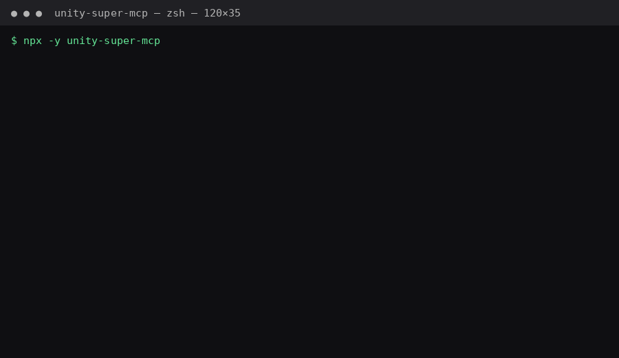

# Unity Super MCP



An MCP server that gives an AI agent 15 tools over a Unity project: Unity Gaming Services LiveOps (Economy, Cloud Save, Cloud Code), build-size and bloat analysis, and store-compliance checks — one install instead of four.

> **Why this exists (read me first).** This was built in a single sitting to win a bet — whether an agent could usefully drive UGS end-to-end. This is the receipt. I build MCP servers and agent infrastructure; I am not a game developer and this is not a pivot into games. It's here as a demonstration of MCP tool design, not a maintained product.

Built entirely through a text-only chat with a mobile AI assistant (no file uploads, no IDE), then verified: the server type-checks clean and boots. Treat it as a reference implementation.

## Install

```bash
npx -y unity-super-mcp
```

### Client config (Claude / Cursor / Windsurf)

```json
{
  "mcpServers": {
    "unity-super": {
      "command": "npx",
      "args": ["-y", "unity-super-mcp"],
      "env": {
        "UNITY_PROJECT_PATH": "/path/to/MyGame",
        "UNITY_PROJECT_ID": "your-project-id",
        "UNITY_SERVICE_KEY_ID": "your-key-id",
        "UNITY_SERVICE_SECRET": "your-secret",
        "UNITY_ENV_ID": "production"
      }
    }
  }
}
```

No UGS credentials? Set only `UNITY_PROJECT_PATH` and you still get the 7 build/compliance tools. The UGS tools report "not configured" instead of failing.

## Tools (15)

**UGS LiveOps (8)** — `ugs_get_project_info`, `economy_list_catalog`, `economy_create_currency`, `economy_create_item`, `economy_create_shop`, `cloudsave_get_player_data`, `cloudcode_list_modules`, `cloudcode_deploy_module`

**Build & Ship (7)** — `build_get_last_report` (largest assets), `build_analyze_bloat` (duplicates, oversized files, Resources/ abuse, unoptimized textures), `build_fix_imports` (generates a C# editor fix script), `assets_find_orphans` (unreferenced-asset heuristic), `build_check_compliance` (Android target SDK, iOS, StreamingAssets bloat), and `super_health_check` — **run this first**; it fans the core checks out in parallel and returns a summary plus next actions.

## Notes

- `super_health_check` is the intended entry point: one call, whole-project readout.
- `assets_find_orphans` is heuristic — verify with `AssetDatabase.GetDependencies` before deleting anything.
- Requires Node 18+.

## License

MIT. Do what you like with it.
